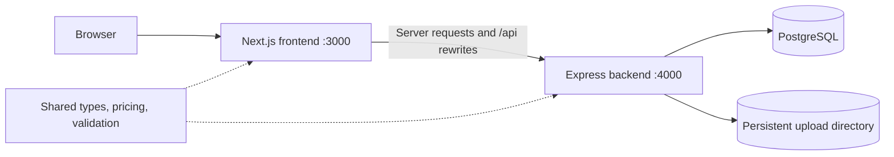

# Architecture

## Application boundaries

`frontend/` owns rendering and browser interactions. `backend/` owns authentication enforcement, validation of incoming requests, persistence, uploads, and business transactions. `packages/shared/` contains contracts and pure business rules used by both applications; it has no database or UI dependencies.

Browser requests use the site's `/api` path. Next.js forwards these requests to `API_INTERNAL_URL`; a production reverse proxy may route `/api` directly to the backend instead. Server-rendered frontend code also reaches the backend through the internal URL. PostgreSQL credentials and JWT signing secrets belong to the backend environment.

## Frontend

- `src/app/(site)/` defines public website pages, including the catalogue and enquiry forms.
- `src/app/admin/` defines sign-in and the administration interface.
- `src/components/` contains page, layout, form, and UI components.
- `src/lib/` contains API clients, shared site content, and browser utilities.
- `src/proxy.ts` redirects visitors without a session cookie away from protected pages. The API remains responsible for authorization.
- `public/` contains branding and static website images.

Next.js uses the repository root for Turbopack resolution and standalone output tracing so workspace dependencies remain available after a production build. The frontend build then copies public assets and static chunks into the standalone artifact. Production startup runs that prepared standalone server.

## Backend

- `src/app.ts` composes HTTP middleware and routes; `src/server.ts` owns the listener and shutdown lifecycle.
- `src/routes/` exposes product, order, admin, and enquiry endpoints.
- `src/services/` implements authentication, catalogue synchronization, and order transactions.
- `src/middleware/` handles admin authorization and image uploads.
- `src/lib/` contains HTTP helpers, product field validation, and response formatting.
- `src/config.ts` validates environment configuration; `src/db.ts` owns the Prisma client and PostgreSQL adapter.
- `prisma/` contains the schema and committed migrations. `src/generated/prisma/` is generated from that schema.
- `src/tests/` contains integration tests and test database setup.
- `uploads/` holds local runtime uploads unless `UPLOAD_DIR` points elsewhere.

The data model includes products, order snapshots and items, admin users, idea submissions, contact messages, and application settings. Stock reservations and status changes run through the order service so concurrent requests use database transactions.

## Authentication and HTTP behavior

Admin sessions use signed JWTs in an HttpOnly cookie, with secure cookies in production and an eight-hour expiry. Backend middleware verifies the session for protected routes and checks request origins for state changes. Passwords use bcrypt hashing. The frontend cookie check is an initial navigation check, not an authorization boundary.

The API includes environment validation, Helmet headers, configured CORS origins, form and login rate limits, bounded request bodies, structured request logs, and a database health endpoint. These controls remain application building blocks; deployment still needs TLS, network configuration, monitoring, backups, and operational ownership.

## Development and release flow

The root npm scripts build shared code before dependent applications. One root lockfile describes all workspaces. CI uses Node.js 24 and a disposable PostgreSQL database to run lint, type checks, tests, and production builds. CI does not deploy releases.

Application environment files, build outputs, generated Prisma files, and uploaded content are excluded from source control. Deployments apply committed migrations explicitly and retain uploaded content outside replaceable release directories. See [the production guide](../deploy/README.md) for the operational sequence.
